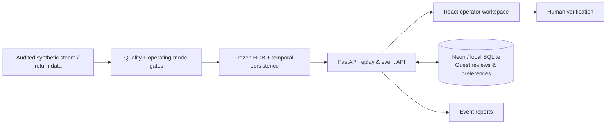

  

<h1 align="center">Fluo</h1>

<strong>Condensate-return monitoring and evidence-led inspection for industrial steam systems.</strong>

  
  
  

  <a href="#overview">Overview</a> ·
  <a href="#prototype">Prototype</a> ·
  <a href="#architecture">Architecture</a> ·
  <a href="#research-evidence">Evidence</a> ·
  <a href="#documentation">Documentation</a> ·
  <a href="#repository-status">Repository status</a>

---

## Overview

Industrial steam systems rely on recovered condensate to conserve water and heat. On a textile yarn-sizing line, a falling condensate-return measurement can have several explanations: a physical loss, an inaccurate meter, process transitions, or transport delay. Treating every deficit as a confirmed leak would be unsafe.

**Fluo is a read-only inspection-support prototype.** It brings together steam/return telemetry, data-quality and operating-mode checks, a frozen histogram-gradient-boosting (HGB) model, event evidence, and a documented operator-review workflow. Its first research setting is one **indirect-steam-heated yarn-sizing branch**.

The model flags a *deficit signature*, not a proven cause. Fluo **does not control boilers or valves**, determine condensate purity, or authorize recovery.

## Prototype

The React/TypeScript + FastAPI application includes:

- **Overview** — steam and return measurements, trends, current quality state, and warning context.
- **Scenario Review** — deterministic playback of archived synthetic scenarios; play, pause, seek and operating-context comparisons.
- **Event Center** — browsable return-flow and data-quality events, filters, and supporting measurements.
- **Event Details** — inspection checklist, notes, saved reviews, and event-specific PDF/print reports.

The backend enforces isolated, time-limited guest workspaces. The audited preview uses **Vercel Hobby with a restricted Neon PostgreSQL store**; the local development path retains SQLite. The original frozen HGB runs in the server runtime.

**[Hosted preview](https://fluo-o3h0wtwma-vlnvns-projects.vercel.app)** · **[Release evidence](docs/RELEASE_STATUS.md)** · **[Guided walkthrough](docs/GETTING_STARTED.md)**

> **Access note:** This is a Vercel-protected preview, not an unrestricted public website. Invited reviewers need a separately issued, revocable share link. The URL above does not bypass provider authentication, and guest access inside Fluo is an additional, independent boundary.

## Architecture

Data provenance, inference rules, API boundaries and hosting decisions are documented in [Architecture](docs/ARCHITECTURE.md). Sensor-to-edge acquisition is a **planned development stage**, not an installed industrial system.

## Research evidence

In the frozen **synthetic fresh holdout**, the selected model raised alerts for **69/71 simulated physical-loss episodes**. This is a simulator result, **not field accuracy**. A 10% negative shift in the return-meter reading caused extensive false-warning minutes; physical loss and sensor under-reading cannot always be distinguished from the available measurements.

The cloud release evidence reports **18/18 hosted Chromium end-to-end tests**, **34 local Python tests**, **6 restricted-Neon tests**, and fingerprint agreement for the original frozen model at runtime. These are software/reproduction checks, **not** evidence of industrial deployment, measured fuel savings, or safety certification.

Read the [validation matrix](docs/VALIDATION.md), [model results](docs/RESULTS.md), and [data lineage](docs/DATA_SOURCES.md) before quoting metrics.

## Documentation

| Start here | Purpose |
|---|---|
| [Documentation index](docs/README.md) | Find a guide, reference, or research record |
| [Getting started](docs/GETTING_STARTED.md) | Explore the hosted preview and run locally |
| [Architecture](docs/ARCHITECTURE.md) | Data flow, system boundaries, persistence |
| [Validation & limitations](docs/VALIDATION.md) | Reproducibility, observed failures, test scope |
| [Release status](docs/RELEASE_STATUS.md) | Exact deployed SHA, evidence and access restrictions |
| [Contributing](CONTRIBUTING.md) | Change control, documentation, review expectations |
| [Security policy](SECURITY.md) | Responsible vulnerability reporting |

Detailed implementation records, API schema, ADRs and release audits are retained on the [application branch](https://github.com/vlnvn/fluo/tree/deploy/vercel-hobby/docs/implementation).

## Repository status

**This default `main` branch contains the research lineage and scripts. The full application, hosted adapter, CI workflow and private-artifact verification code are in [`deploy/vercel-hobby`](https://github.com/vlnvn/fluo/tree/deploy/vercel-hobby) ([draft PR #2](https://github.com/vlnvn/fluo/pull/2)).** A secure local prototype is separately tracked in [draft PR #1](https://github.com/vlnvn/fluo/pull/1). Neither PR is presented as merged production code.

The protected hosted preview was built from commit [`ab3ebc9`](https://github.com/vlnvn/fluo/commit/ab3ebc9650cabdc9e90f46b3e27df0959a904f50), **not** from the current default branch. Subsequent documentation commits should not be confused with the tested application revision.

The research, facility and telemetry are synthetic. There is no verified plant installation, customer, savings result, or physical control. The repository currently **does not grant an open-source license**; public visibility must not be mistaken for permission to reuse or redistribute project code. Third-party assets retain their own rights.

---

Fluo · DEEPX 2026 research prototype · Last documentation review: 25 October 2026
