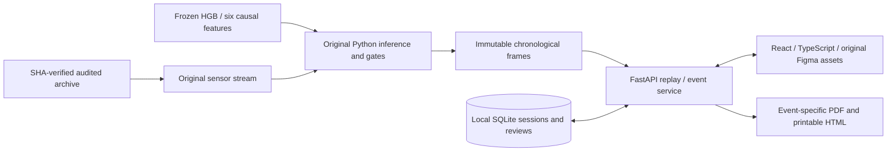

# Fluo — local operator workspace

Latest [release audit](docs/implementation/qa/FINAL_RELEASE_AUDIT.md), [evidence handoff](docs/implementation/PROPOSAL_EVIDENCE_HANDOFF.md), [real recorded demo](docs/implementation/demo/DEMO_SCRIPT.md) and [deployment runbook](docs/implementation/deployment/DEPLOYMENT_RUNBOOK.md). Expiring guest authentication and object ownership are implemented. PUBLIC_DEPLOYMENT_BLOCKED: hosting access, billing approval and actual HTTPS/persistence verification remain outstanding.

Functional React/TypeScript + FastAPI prototype using the **original frozen HGB** and the supplied audited telemetry. Four operator pages, nine recorded scenario windows, replay, quality gates, events, persisted reviews/preferences, genuine PDF and A4 print are implemented. Research scripts and historical results below remain unchanged.

## Install and run (Windows PowerShell)

Prerequisites: Python **3.12 or 3.13**, Node.js 22.12+ with npm, and the original `FLUO_ML_RESEARCH_AUDITED_20261024.zip` next to this checkout. No cloud credentials are required. Stop Fluo before installation because Windows locks running dependencies.

```powershell
cd C:\College\DEEPX\fluo
.\setup.ps1
.\.venv\Scripts\python.exe tools\dev.py
```

Open http://127.0.0.1:5173 and start a private guest workspace. Research docs endpoints are disabled. The launcher reports readiness only after both services answer. Ctrl+C stops its own child processes. Logs: `.local/api.log`, `.local/web.log`. If Python is not detected: `./setup.ps1 -PythonPath C:/path/to/python.exe`.

`setup.ps1` verifies ZIP SHA-256 and every package checksum, materializes original data without overwriting conflicting files, verifies the selected model and installs locked web dependencies. It never trains. For a different archive location set `$env:FLUO_ARCHIVE_PATH` explicitly; `.env.example` documents optional process environment variables (not automatically loaded).

For a built single-origin application:

```powershell
cd web
npm run build
cd ..
.\.venv\Scripts\python.exe -m uvicorn backend.app:app --host 127.0.0.1 --port 8000
```

Then open http://127.0.0.1:8000. Build **before** starting the API so the static mount exists. Alternatively run API and `npm run dev` in two terminals. These are loopback research services with expiring private guest capabilities; human operator identity remains unverified.

## Reproducible demonstration

1. First open loads recorded Return diversion, paused after an actual warning. Compare Overview readings and signature score with `/api/v1/sessions/{id}`.
2. Scenario Review → Reset → Play. One archived minute advances per wall-clock second at 1×; speed, seek, rewind/forward (10 samples) and pause share one backend cursor. Select normal, meter-bias, outage or mode windows to examine withheld/ambiguous evidence.
3. Event Center → Filters → All / Return / Data quality → Apply. Search, sort and pagination operate on recorded events through the current cursor.
4. Open an event; change a verification checkbox, enter a note, Save draft and reload. Record operator review explicitly. This never clears the model warning or authorizes recovery.
5. View inspection summary → Download PDF / Print. Each selected event has its own data. A4 includes measurements, quality, limitations, model/dataset hashes and operator review; review notes/audit use an appendix.
6. Collapse/expand sidebar or use contextual Notifications, Help, Profile, Preferences. State persists. Notification badges show exact unread counts for the active session/configuration, retain their count across page navigation and only clear on explicit Mark all as read. Warning sound is off by default and requires opt-in plus a newly crossed detector event; browser autoplay rules still apply.

The facility PT Arunika Tekstil / Pabrik Bandung / Unit Sizing A is fictional. `simulated research telemetry` is disclosed in status/provenance and reports. No connected ESP32, physical diagnosis, industrial savings, field validation or safe-to-recover determination is asserted.

## Architecture and source map



- `backend/`: trusted artifact adapter, strict schemas, replay/events, SQLite, reports and API.
- `web/src/`: four routes, contextual dialogs, real SVG charts, typed API client and Figma CSS.
- `web/public/assets/`: original exported SVGs, supplied notification chime and licensed fonts.
- `tools/`: checksum audit, preparation, parity verification, contract generation, design comparisons and dev launcher.
- `tests/`, `web/tests/`: API/model/security and real Chromium workflows.
- `docs/implementation/`: source reconciliation, ADR, generated OpenAPI, 83-frame traceability and QA evidence.
- `data/`, `.local/`, downloaded private source text, screenshots and visual diffs stay local and are ignored by Git.

See [implementation report](IMPLEMENTATION_REPORT.md), [source inventory](docs/implementation/SOURCE_INVENTORY.md), [architecture](docs/implementation/ADR-001.md), [API](docs/implementation/API_CONTRACT.md), and [visual QA](docs/implementation/qa/VISUAL_QA.md).

## Verification

With services running for browser tests:

```powershell
$env:OMP_NUM_THREADS='1'
$env:OPENBLAS_NUM_THREADS='1'
.\.venv\Scripts\python.exe tools/verify_inference.py
.\.venv\Scripts\python.exe -m pytest -q
.\.venv\Scripts\python.exe -m ruff check backend tools tests
cd web
npm run lint
npm run typecheck
npm test
npm run build
npx playwright install chromium
npm run test:e2e
cd ..
.\.venv\Scripts\python.exe tools/design_audit.py
```

Eight screenshot baselines are retained locally and excluded from Git. A new checkout must obtain the reviewed baselines from the private QA artifacts; alternatively generate them with `npx playwright test tests/visual-regression.spec.ts --update-snapshots`, review them against Figma, then run normally. Baseline creation itself is not visual approval. For motion recording install the matching encoder with `npx playwright install ffmpeg`, then run `node tools/probe_visual.mjs` from the repository root.

Existing local Chromium can be supplied through `FLUO_BROWSER_PATH`. Test output includes actual downloaded PDFs, A4 HTML captures and JSON results. Design comparisons require the already downloaded private Figma references, which remain local. Font rebuild is optional: install fonttools + brotli then run `tools/prepare_report_fonts.py`; generated TTF assets already ship in this checkout.

## Scientific and operational boundaries

Model SHA-256: `5237917ae6ccfccd2ff21d288b92201536c923028d8931599aaf9715033e9b09`. SHA is checked before deserialization. Do not load untrusted external joblib files. HGB uses strict score >0.90, original 5/10 persistence and warmup/connectivity gates. Scores are uncalibrated synthetic signature scores; physical loss and meter under-reading can be observationally ambiguous. Recovery remains a human engineering assessment. Oracle labels only locate research scenario windows, never enter runtime inference or diagnosis.

The original function fails on zero-valid-row prefixes; the adapter supplies an empty score array for that case only. Nonempty predictions are exactly preserved. Full chronological history is scored once at service startup and never trained in request paths. Historical experiment dates/seeds and original metrics are not rewritten.

Visual comparisons cover 20 representative states, with all 83 Figma frames mapped to runtime state. This is **not a pixel-identical claim**: dynamic telemetry, truthful event content, font rasterization and additional functional controls differ. No public deployment, verified operator identity, hardware/plant pilot or production-readiness certification is included. Existing repository rights remain unchanged; third-party font licenses are retained. No archive/private document upload or Git push was performed.

---

## Original research README (preserved)

# fluo

Steam-condensate monitoring and inspection decision support for industrial steam systems. The initial research case is indirect steam heating in textile yarn sizing.

## Status

Research prototype. The sensor records and fault events in this repository are simulated, **not collected from an Indonesian textile mill**. No production deployment, field accuracy, fuel savings, or safe-to-recover decision has been validated. Fluo never controls a valve or a boiler.

## Architecture

1. Generate documented synthetic steam/return telemetry with an explicit mass balance.
2. Establish threshold and physics-residual baselines.
3. Fit a supervised deficit-signature model using synthetic training labels, never hidden truth as model input.
4. Evaluate by event, nuisance alarms, latency, sensor drift, missing values, and unseen simulator configurations.
5. Produce read-only inspection recommendations; require instrument checks and engineer approval before condensate recovery.

## Reproduce

```bash
python -m pip install -r requirements.txt
python bootstrap_dataset.py
python prepare_cohorts.py
python compare_models.py
python generate_final_holdout.py
python final_validation.py
python run_fluo_v2.py
python qa_and_demo.py
python robustness_stress.py
```

The historical v2 benchmark is documented in `docs/HISTORICAL_V2_REPORT.md`. The original synthetic dataset is generated automatically by `bootstrap_dataset.py` when its ZIP is not present. Additional cohorts are generated by the supplied scripts; no factory recordings are included. See `docs/RESULTS.md` and `docs/DATA_SOURCES.md` for scope, caveats and source references. Training uses simulated event annotations as **targets** only, not as input features. Scores are not calibrated probabilities of physical condensate loss.

## Boundaries

- A low condensate meter reading may reflect lost condensate, meter bias, startup, transport lag or other operating changes.
- Return meter bias and physical loss are not uniquely identifiable from two flow meters alone.
- Model calibration, instrument quality, and condensate contamination must be reviewed per site.
- Cross-seed simulation results do not establish performance at an actual plant.

## License and data

Technical references are linked in `docs/DATA_SOURCES.md`. Literature and vendor reports are attributed; only code and synthetic artifacts generated for this research are offered here. No open-source license is granted here yet; contact the repository owner before reusing or redistributing the code.
