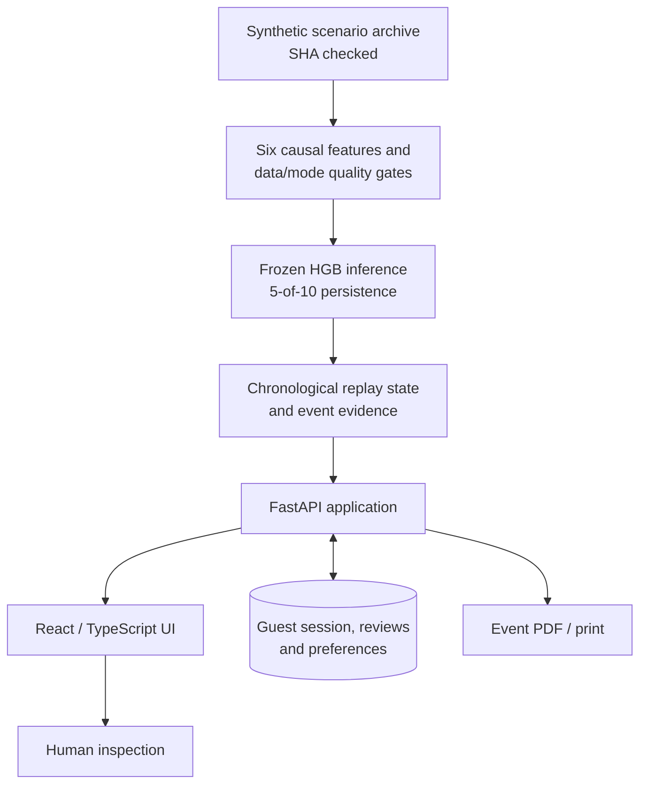

# System architecture

**Scope:** Fluo's recorded research prototype, based on the frozen October 2026 model. This page distinguishes what is implemented from what is planned.

## Components

The **research input** and **operator state** have separate roles. Synthetic telemetry and the frozen model are immutable inputs to runtime inference; user notes, reviews and preferences are stored under guest ownership. The runtime model artifact SHA-256 is `5237917ae6ccfccd2ff21d288b92201536c923028d8931599aaf9715033e9b09`. Do not deserialize an untrusted replacement.

## Execution paths

| | Local prototype | Access-controlled preview |
|---|---|---|
| UI | Vite/React | Built React application |
| API | FastAPI | FastAPI on Vercel Python |
| Guest state | SQLite | Restricted Neon PostgreSQL |
| Model | Original frozen HGB | Same model, fetched privately and hash-verified |
| Input | Audited synthetic archive | Audited synthetic runtime payload |
| Reviewer access | Loopback development | Vercel Authentication/share gate **and** Fluo guest workspace |

The hosted runtime does not fall back to ephemeral SQLite. The restricted database role cannot run schema migrations or write research artifacts. A two-hour guest session is a *workspace capability*, not proof of a human operator's identity.

## What an alert means

1. Check timestamps, connectivity, meter state and operating mode. Do not score untrustworthy windows.
2. Compute the established causal features and execute the frozen HGB; the model emits a synthetic deficit-signature score.
3. Apply warmup, reconnect and persistence rules before presenting a warning.
4. Preserve measurement context and instrument uncertainty in event evidence.
5. Have a person inspect the meter, routing and steam trap before making an engineering decision.

A physical loss and a low-biased return meter can produce similar readings. Fluo does **not** determine the leak location, condensate cleanliness or whether recovery is safe. No boiler/valve actuation endpoint is part of the research goal.

## Planned, not deployed

The proposed sensor/edge/gateway path includes field meter calibration, quality checks at acquisition, local rule alarms and offline buffering. These have **not** been demonstrated on a textile plant or industrial hardware. The named facility in the UI is fictional.

## Deeper references

- [Local application ADR](https://github.com/vlnvn/fluo/blob/deploy/vercel-hobby/docs/implementation/ADR-001.md)
- [Vercel/PostgreSQL ADR](https://github.com/vlnvn/fluo/blob/deploy/vercel-hobby/docs/implementation/ADR-002-VERCEL-POSTGRES.md)
- [API contract](https://github.com/vlnvn/fluo/blob/deploy/vercel-hobby/docs/implementation/API_CONTRACT.md)
- [Threat model](https://github.com/vlnvn/fluo/blob/deploy/vercel-hobby/docs/implementation/deployment/THREAT_MODEL.md)
- [Release status](RELEASE_STATUS.md)
