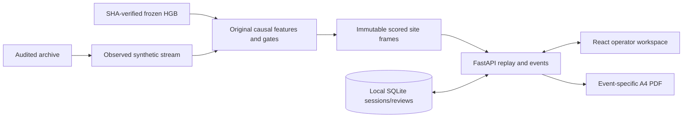

# ADR 001 — frozen inference, immutable replay and local review persistence

Status: accepted implementation decision, 25 October 2026.

The repository has Python research code and a selected HGB artifact, no HTTP backend or frontend. Keep all research scripts and frozen reports unchanged. Add FastAPI, Pydantic, SQLite and React/TypeScript/Vite with ordinary CSS. No cloud, MQTT, broker, device emulator or authentication is needed for this local research prototype.

The supplied ZIP supplies the original recorded synthetic stream. Score complete chronological site histories once using the unchanged `run_fluo_v2.inference`; expose immutable frames through the API. Seeking never recomputes a truncated history or changes predictions. Original telemetry timestamps, one-minute cadence, site and units remain intact. Runtime inference accepts only the 13 sensor fields. Scenario setup annotations select windows offline; oracle values never enter inference, event classification or UI readings.

`FrozenEstimator` checks the expected SHA-256 before loading the trusted, user-provided artifact. It returns an empty score matrix only when upstream asks to score zero valid rows; nonempty calls use the original predictor. This fixes the observed warmup-prefix crash without retraining or changing scientific behavior. Parity tolerance is zero for valid sample outputs. Original persistence uses 10 rows, invalid candidates false, plus quality/reconnect gating; it is not rewritten to match an inaccurate source comment.

Sessions store scenario/cursor/speed and an anchored replay clock in SQLite. 1× means one archived one-minute sample per wall-clock second, explicitly disclosed. GET computes the current cursor, pause freezes it, reset/seek/scenario commands establish a new anchor. HTTP responses contain only the current/past chart window. Event history includes prior recorded state transitions for the selected configuration and never future detections. Event IDs are deterministic from configuration and chronological state change, not simulator labels.

Review drafts and explicit submissions persist per local session/operator. There is no verified identity; the UI and reports disclose `Local operator (unverified)`. Submitted checkboxes never clear an alarm, authorize recovery or change ML output. Optimistic revision checks prevent conflicting writes. Parameterized SQL and strict request schemas protect this local interface; it is not exposed as a multi-user service.

Original Figma SVG assets are local files. Live charts use recorded measurements and share Figma geometry; illustrative chart vector assets are retained for design reference, not displayed as telemetry. Figma typography and the 1440×900 Full/Compact reference layout drive CSS tokens and responsive grid proportions. Native accessible checkboxes/dialog focus handling replace purely visual Figma instances. ReportLab creates genuine event-specific A4 PDFs; browser print uses the corresponding report route and A4 CSS.

## Flow

Remaining scientific boundary: same simulator family; no actual textile mill, hardware telemetry, diagnosed loss, validated savings or recovery permission.
