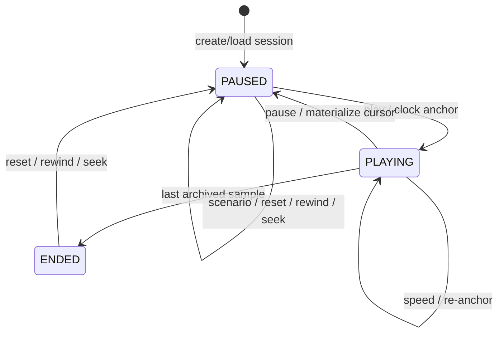
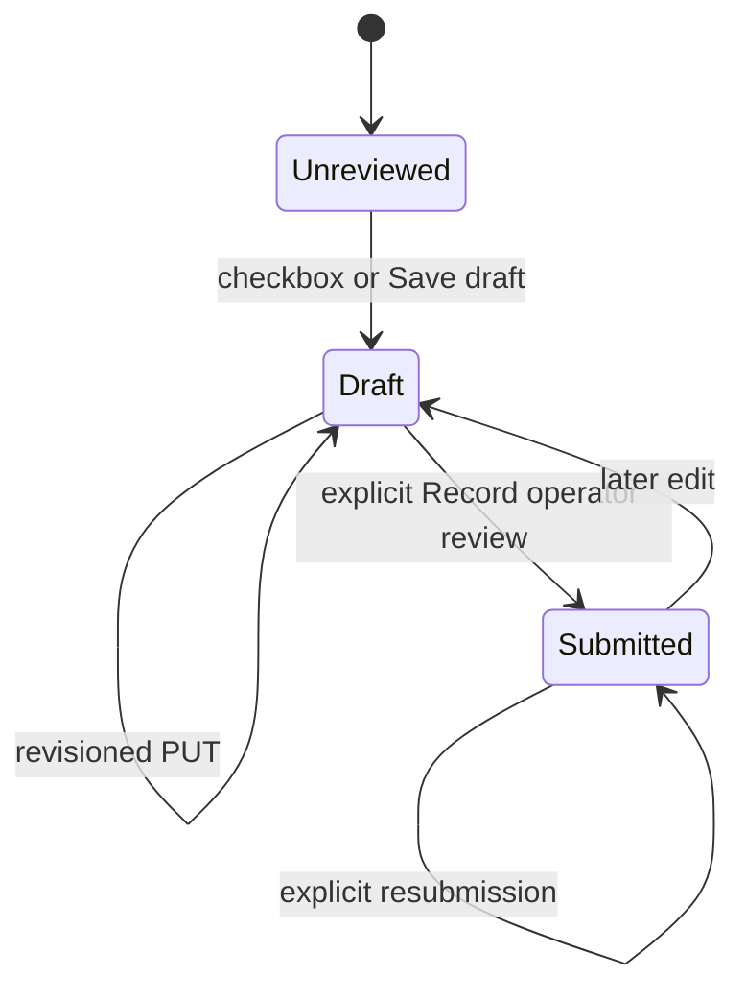

# Runtime states and Figma tokens

The source is Figma `M1xy04eLqGOsjH505y99mW`, ui/ux page `49:35`, Full start `74:2` and Compact start `128:5`. Exact extracted bounds are in FIGMA_GEOMETRY.json and the 83-frame state map is in FIGMA_TRACEABILITY.md.

| Design concern | Runtime token / geometry | Implementation |
|---|---|---|
| Light canvas / white cards | #f5f9ff / #ffffff | styles.css --canvas / --surface |
| Primary / secondary text | #162c42 / #50657b | --ink / --muted |
| Primary action / selected tint | #1d52c4 / #e7f2ff | --blue / --tint |
| Borders / chart separators | #d9e7f5 / #dce8f5 | --border / --line |
| Warning / card radius | #a65a11 / 14px | --amber / --radius |
| Shell | Full225px, Compact76px, header70px | .sidebar / .app.is-compact / header |
| Content | Full x255px, Compact x106px, top97px; Scenario y96px | page grid / captured bounds |
| Filter | 675×624 white panel | native modal with explicit Apply/Reset |
| Fonts | Archivo variable; Barlow Condensed600 for numeric display | bundled Fontsource assets |
| Logo / icons | original Figma SVG files, Compact original variant | public/assets |

## State transitions

Scenario commands replace the active window and cursor deterministically. Pause/seek responses and later requests share immutable model results, SQLite session identity and a generation guard against stale polling. Route, sidebar and filter states are independent of the replay cursor. Context overlays retain the underlying route and DOM; escape/close restores trigger focus. Dialog Tab containment is explicit.

A checkbox draft and a submitted review are operator records, not machine health transitions. Warnings, unconfirmed cause, read-only restrictions and recovery eligibility remain governed by original scientific evidence. Stale revisions return409; records are independent per session/event. Notes persist on Save draft or submit, rather than on each keystroke. Filters similarly stage changes until Apply.
